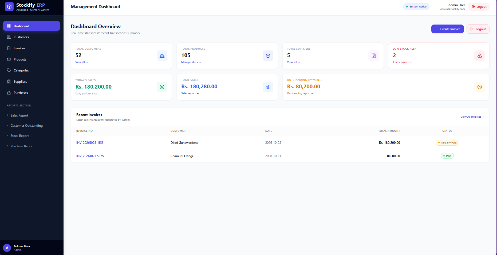
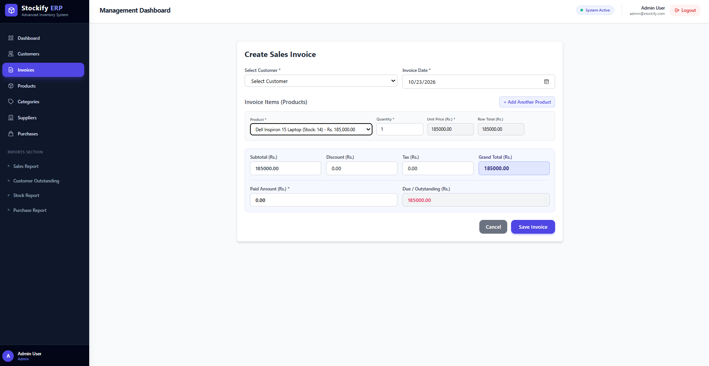
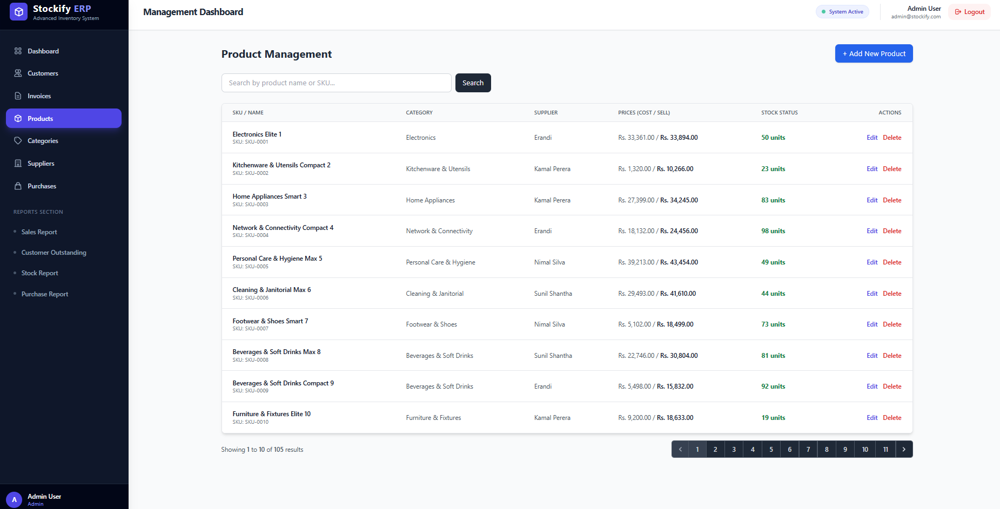
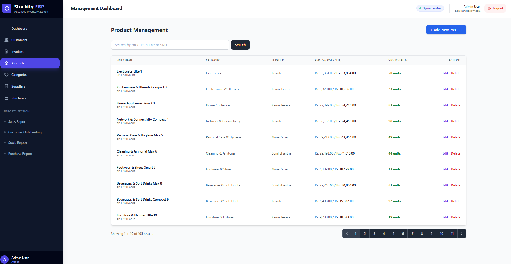

# Stockify ERP - Advanced Sales & Inventory Management System

A robust, enterprise-grade Sales and Inventory Management Web Application built with **Laravel** and **MySQL**. The system strictly adheres to role-based access control, atomic database operations via transactions, real-time stock validations, and automated customer payment tracking.

---

## 🚀 Key Features & Business Logic

### 1. Authentication & Role-Based Authorization (RBAC)
- **Secure Authentication:** Password hashing using bcrypt with session management.
- **Role Permissions:**
  - **Admin:** Full system access (Dashboard, User Management, Master Data, Sales, Purchases, Reports).
  - **Sales User (Manager):** Access to Customers, Invoices, Payments, and Sales Reports.
  - **Inventory User (Cashier):** Access to Products, Categories, Suppliers, Purchases, and Stock Reports.

### 2. Real-Time Dashboard
- Displays dynamic KPI metrics: Total Customers, Products, Suppliers, Today's Sales, Total Sales, and Total Outstanding Payments.
- Visual alerts for **Low Stock Products** based on defined reorder levels.
- Recent sales invoice overview.

### 3. Master Data Management (CRUD)
- **Category Management:** Categorize products with status indicators.
- **Supplier Management:** Track supplier contact details and company information.
- **Product Management:** Complete details including SKU/Product Code, Cost Price, Selling Price, Quantity, and Reorder Levels.

### 4. Stock & Purchase Management
- **Automatic Stock Increment:** Completing a purchase transaction automatically updates inventory ($\text{New Stock} = \text{Existing Stock} + \text{Purchased Quantity}$).
- **Stock Validation:** Prevents negative stock balances during sales transactions.

### 5. Sales Invoice & Payment Calculations
- **Dynamic Product Pricing & Calculations:** Automatic unit price autofill and real-time total, discount, tax, subtotal, and grand total calculations.
- **Stock Decrement:** Deducts sold items upon invoice generation ($\text{New Stock} = \text{Existing Stock} - \text{Sold Quantity}$).
- **Payment Handling:** Supports Full, Partial, and Unpaid invoice statuses.
- **Automated Outstanding Balance:** Dynamic balance calculations ($\text{Outstanding} = \text{Grand Total} - \text{Paid Amount}$).

### 6. Atomic Database Transactions
- Wrap critical purchasing and sales invoicing logic in `DB::transaction()` to ensure atomicity and data consistency in case of runtime errors.

### 7. Analytical Reports & Invoice Printing
- **Sales Report:** Filter by date range and specific customers.
- **Stock Status Report:** Displays stock status and reorder warnings.
- **Purchase Report:** Supplier purchase history with date filtering.
- **Customer Outstanding Report:** Clear breakdown of total sales, payments, and outstanding balances.
- **Printable Invoices & Reports:** Print-ready formatting for official records.

---

## 🛠️ Tech Stack & Requirements

- **PHP:** >= 8.2
- **Framework:** Laravel 11.x / 10.x
- **Database:** MySQL / MariaDB
- **Frontend Stack:** Tailwind CSS, Blade Engine, JavaScript (ES6)
- **Package Manager:** Composer & NPM

---
## 💻 Installation & Local Setup Guide

Follow these step-by-step instructions to install and run the application locally:

### 📋 System Requirements
Ensure your local development environment meets the following:
- PHP >= 8.2
- Composer
- Node.js & NPM
- MySQL / MariaDB

## ⚙️ Installation & Setup

Follow these steps to set up the project locally on your machine:

1. **Clone the repository:**
   ```bash
   git clone [https://github.com/Erandi-Hans/Stockify-ERP.git](https://github.com/Erandi-Hans/Stockify-ERP.git)
     cd Stockify-ERP
2. **Install PHP dependencies:**
    ```bash
   composer install

3. **Configure Environment File:**
    ```bash
   cp .env.example .env
    php artisan key:generate

4. **Configure Database:**
   Open your .env file and update your database credentials:
    ```bash
   DB_CONNECTION=mysql
   DB_HOST=127.0.0.1
   DB_PORT=3306
   DB_DATABASE=stockify_db
   DB_USERNAME=root
   DB_PASSWORD=

5. **Run Migrations & Seeders:**
    ```bash
   php artisan migrate:fresh --seed

6. **Start the Local Development Server::**
    ```bash
   php artisan serve
  Open your browser and navigate to: http://127.0.0.1:8000

---

## 📁 Project Structure

    ```text
    Stockify-ERP/
    ├── app/
    │   ├── Http/
    │   │   ├── Controllers/
    │   │   │   ├── AuthController.php
    │   │   │   ├── CategoryController.php
    │   │   │   ├── CustomerController.php
    │   │   │   ├── DashboardController.php
    │   │   │   ├── InvoiceController.php
    │   │   │   ├── ProductController.php
    │   │   │   ├── PurchaseController.php
    │   │   │   ├── ReportController.php
    │   │   │   └── SupplierController.php
    │   │   └── Middleware/
    │   │       └── CheckRole.php
    │   └── Models/
    │       ├── Category.php
    │       ├── Customer.php
    │       ├── Invoice.php
    │       ├── InvoiceItem.php
    │       ├── Payment.php
    │       ├── Product.php
    │       ├── Purchase.php
    │       ├── PurchaseItem.php
    │       ├── Role.php
    │       ├── Supplier.php
    │       └── User.php
    ├── database/
    │   ├── migrations/
    │   └── seeders/
    │       ├── AdminUserSeeder.php
    │       ├── CustomerSeeder.php
    │       ├── DatabaseSeeder.php
    │       ├── ProductSeeder.php
    │       ├── RoleSeeder.php
    │       └── SupplierSeeder.php
    ├── resources/
    │   └── views/
    │       ├── auth/
    │       │   └── login.blade.php
    │       ├── categories/
    │       ├── customers/
    │       ├── invoices/
    │       ├── layouts/
    │       │   └── app.blade.php
    │       ├── products/
    │       ├── purchases/
    │       ├── reports/
    │       │   ├── outstanding.blade.php
    │       │   ├── purchase.blade.php
    │       │   ├── sales.blade.php
    │       │   └── stock.blade.php
    │       ├── suppliers/
    │       ├── dashboard.blade.php
    │       └── welcome.blade.php
    ├── routes/
    │   ├── console.php
    │   └── web.php
    ├── .env.example
    ├── composer.json
    ├── package.json
    └── README.md
    
## 🔑 Demo Login Credentials

The application comes pre-seeded with sample user accounts for testing each authorization role:

| Role | Name | Email | Password | Allowed Modules |
| :--- | :--- | :--- | :--- | :--- |
| **Admin** | Admin User | `admin@stockify.com` | `Password@123` | Full System Access |
| **Sales User** | Sales Manager | `sales@stockify.com` | `Password@123` | Customers, Invoices, Payments, Sales Reports |
| **Inventory User** | Cashier User | `inventory@stockify.com` | `Password@123` | Products, Categories, Suppliers, Purchases, Stock Reports |

---

## 📷 Application Screenshots

*(Upload your screenshots to your repository under a `public/screenshots/` folder or drag & drop them into GitHub issue/PR to get image links, then replace the image paths below)*

| Dashboard Overview | Sales Invoice Creation |
| :---: | :---: |
|  |  |

| Product Management | Customer Outstanding Report |
| :---: | :---: |
|  |  |

---
---
## 🛡️ License
This project is developed for enterprise assessment purposes.

---
